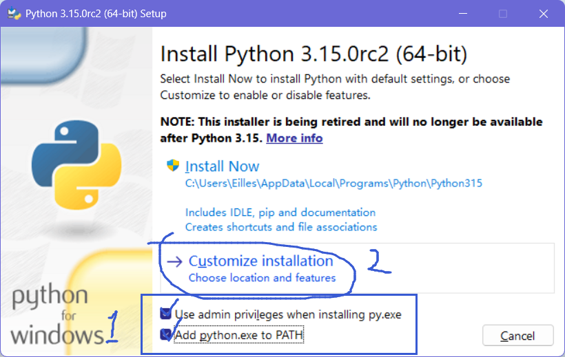
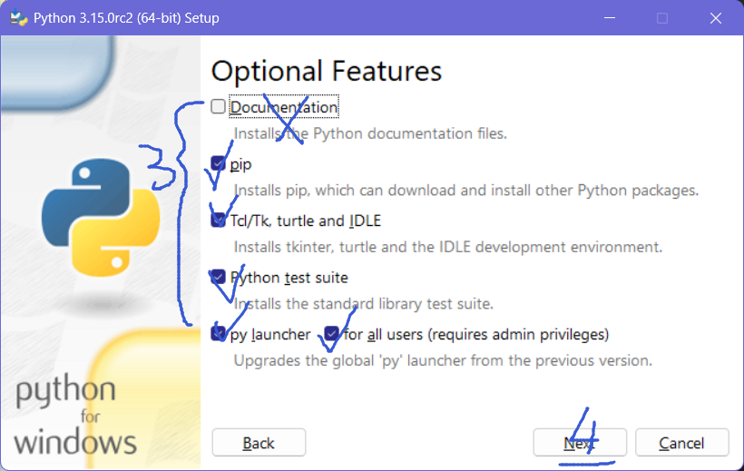
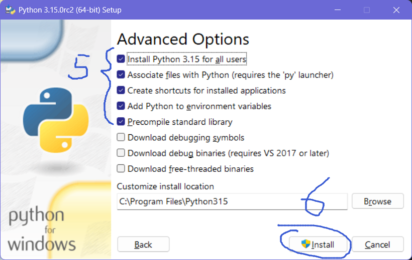
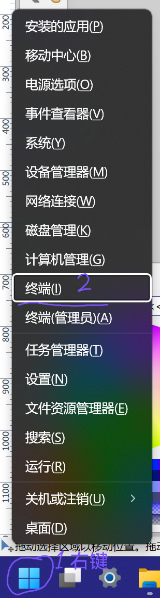

> 版权所有 © 2026 [菀金羿](https://github.com/EillesWan)
> 
> 保留所有权利。
>
> 文档遵循 [知识共享 署名—非商业性使用—相同方式共享 4.0 协议](https://creativecommons.org/licenses/by-nc-sa/4.0/deed.zh-hans) 协议发布，转载时请注明原地址及原作者信息以及本协议之地址，其中作者信息必须包括原作者的昵称（菀金羿或Eilles）、原作者的任意平台链接地址（[GitHub用户页](https://github.com/EillesWan)、[Bilibili个人页](https://space.bilibili.com/397369002)或其他个人页面）；未满足上述条件的任何使用都将被依法追究责任。

> Copyright © 2026 [Eilles](https://github.com/EillesWan),
> 
> All rights reserved.
>
> This document is licensed under the [Creative Commons Attribution-NonCommercial-ShareAlike 4.0 International License](https://creativecommons.org/licenses/by-nc-sa/4.0/deed). When reposting or redistributing, you must include the document's original link, original author information and the link to the license. The author information must include the author's name (Eilles) and any link address of the original author's personal page (like [Github Overview Page](https://github.com/EillesWan), or [Bilibili Space Page](https://space.bilibili.com/397369002), etc). Any use that does not meet the above conditions will be considered illegal.


## 安装运行环境

Python 是一款<u>解释性程序设计语言</u>*，我们首先要在你的设备上安装 Python 解释器才能够运行 Python 语言的代码。

> 解释性程序设计语言：指的是在代码执行过程中，由解释器将程序码逐一转换为计算机进行操作的指令，再交由机器执行的一种程序设计语言。

### Windows 设备

首先，[点击此处即可从 Python 官网下载 Python 解释器](https://www.python.org/ftp/python/3.10.11/python-3.10.11-amd64.exe)，并如下图所示安装。





好了，安装完成，接下来，我们来测试一下 Python 是否安装成功。

1. 用鼠标右键你的开始菜单，打开“终端”（在 Windows 8~10 下，右键开始菜单，打开“PowerShell”；在 Windows 95~7 下，请在开始菜单搜索“cmd”，打开“命令提示符”）如下图：

<table><tr>
<td></td>
<td></td>
</tr><tr><td>Windows 11</td><td>Windows 10</td></tr></table>


### Android 设备

> 以下教程修改自笔者的其他仓库内容，因此依照**汉钰律许可协议，第一版**授权。
> 任何人皆可从以下地址获得本协议副本：https://gitee.com/EillesWan/YulvLicenses。
> 若非因法律要求或经过了特殊准许，此作品在根据本协议“原样”提供的基础上，不予提供任何形式的担保、任何明示、任何暗示或类似承诺。也就是说，用户将自行承担因此作品的质量或性能问题而产生的全部风险。
> 详细的准许和限制条款请见原协议文本。

####	安装终端工具

这里我们选用 **Termux** 作为我们的终端工具来安装，这是一个强大的终端模拟器，旨在安卓环境下模拟 Linux 的软件包环境。在我们这个的教程里，使用终端工具的主要目的就是来运行 Python。

> **注意** 若你的设备中已经有终端工具（例如 Utermux 之类的），请跳过此步骤。

1.	下载

	下载可以通过 [GitHub源](https://github.com/termux/termux-app/releases) 或者 [F-Droid源](https://f-droid.org/en/packages/com.termux/) ，个人建议选择 F-Droid 源，因为在国内可以访问得到，而 GitHub 源就看运气。

2.	安装

	下载*APK*包后直接安装，安装后打开可以看到一个类似这样的界面：

	

3.	完成
    
	恭喜你，你已经获得了一个极客般流畅地操作你手机的终端工具。

####	安装运行环境

1.	换源

	接下来，我们就要来准备安装一下 **Python** 运行环境了，这是运行 **Python** 源代码必要的。

	首先，我估计你等不了多久，急得要死，所以我们要让下载速度稍微快一点，先来换个源。在 **Termux** 中，输入以下指令：

	> **注意** 这条指令很长，执行时请左右滑动以复制全部内容。

	```bash
	echo "deb https://mirror.mwt.me/termux/main stable main" > /data/data/com.termux/files/usr/etc/apt/sources.list
	```

	*感谢 天如<QQ 3291691454>为我们带来的简单换源方法。*

    <details open>

	<summary>*非必要步骤*：手动编辑换源</summary>

	> **注意** 这是非必要的步骤，执行了也没有好处，小白别闲着没事干。

	如果你闲着没事，非要要手动编辑个文档来换源，那就可以遵循这一部分的内容，我们先打开 **nano** 吧。

	在 **Termux** 中，输入以下指令：

	```bash
	export EDITOR=nano
	apt edit-sources
	```
	
	那么请把看到的如左下图的界面变为右下图吧：

	<table><tr>
	<td></td>
	<td></td>
	</tr></table>

	- 图片中的文件，最后应该加入的两行为：
	
		```bash
		deb https://mirrors.ustc.edu.cn/termux/apt/termux-main/ stable main
		deb https://mirrors.tuna.tsinghua.edu.cn/termux/apt/termux-main/ stable main
		```

	然后键入 `Ctrl`+`S`，再键入 `Ctrl`+`X`，退出`nano`。

	</details>

	在换源之后，你可能会见到类似的提示（“可能会”的意思是也可能不会）：

	```bash
	Your '/data/data/com.termux/files/usr/etc/apt/sources.list' file changed. Please run 'apt-get update'.
	```

	那就遵循它的指引（但无论出没出现上面的那个提示，都请执行下面的指令），输入：

	```bash
	apt-get update
	```

	Alright.
	
2.	安装 **Python**

	```bash
	apt-get install python3
	```

	如果遇到提示问是否继续，那就输入`Y`表示是（如下左图），安装成功后，图若下右。

	<table><tr>
	<td></td>
	<td></td>
	</tr></table>

	接下来，我们来试一试 **Python** 是不是安装成功了吧，输入

	```bash
	python3 -V
	```

	如果输出了形如 `Python 3.X.X` 的提示，则完成。

> 特殊授权部分结束

### Linux 或 Mac 设备

不好意思，我歧视 Mac 用户，因此不写 Mac 的安装教程。至于 Linux，你都用 Linux 了，你自己还不清楚怎么安装 Python 吗？

## 测试第一个程序

现在，让我们在桌面上新建一个文本文档，并输入以下内容：

```python
print("Hello World!")
```


> TODO: 未完待续。


在结束这一部分之后，我给大家提供一个流程，这样的流程是需要你自己参考完成的。

1. 给人工智能描述你的目标，并拿到它给出的代码
2. 观察代码，通过所学习的部分内容，来尝试自己用大脑运行这一段代码
3. 运行代码，观察结果，查看不同点
4. 问人工智能，为何不同

实际上，在当下我们这样一个人工智能时代，我们学习一门语言对于人力需求已经大大减少了。但是大多情况下都需要一个人去指导，以更好地适配这个学习流程。曾经我们在没有人工智能的时候，也在书上有这样的过程，只是没什么人标注出来而已。差不多完成一个章节之后，就会有一个题目或者动手做环节嘛，然后就是这个流程。惟一的差别是，我们那会是老师在指导我们完成这个流程，现在你要自己来。

当然可能，你自己不知道怎么来，这种情况下，来社团群里问问大佬吧。

另外的，这个教程主要是根据 Python 语言的功能来分段的，因此有些部分的内容可能略长略短等等，反正这个文章写在这里，你想看多少看多少，自己分配, please.

还有一件事，请你阅读的时候一定要带着你的代码执行工具来读，别对着教程鞥造，读到有代码的地方一定要运行测试，请不要总是把自己当成肉编器。

<CommentService/>